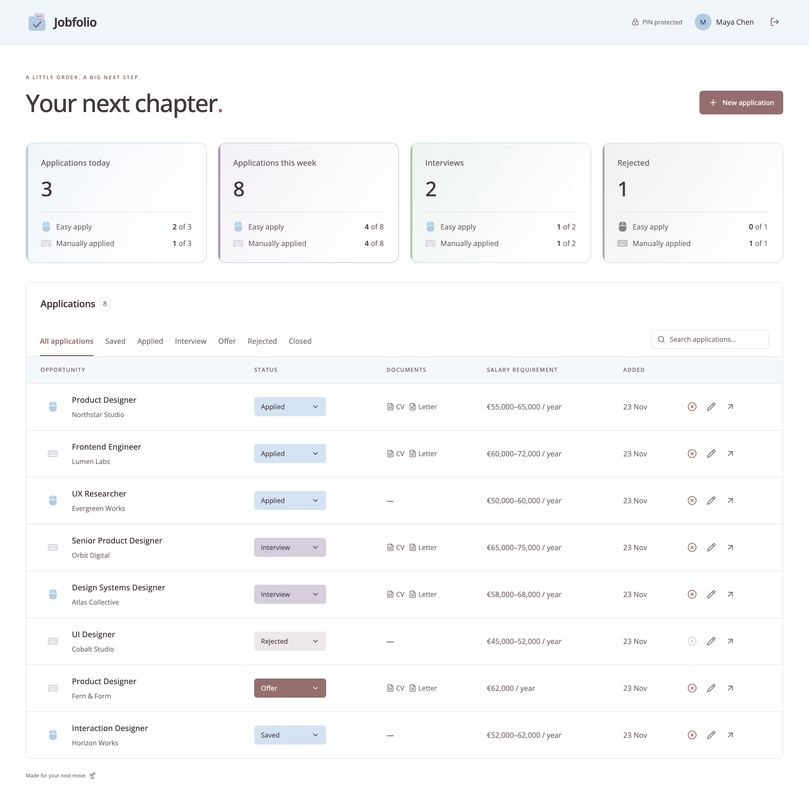
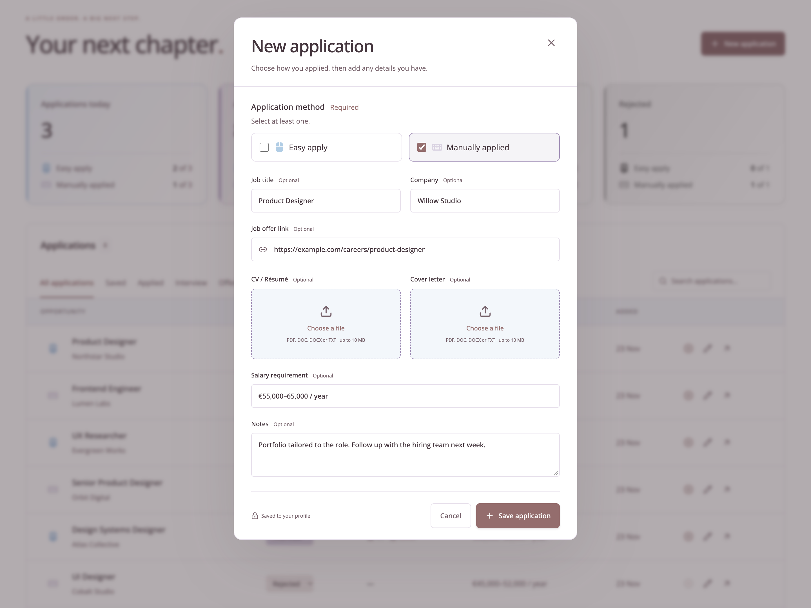
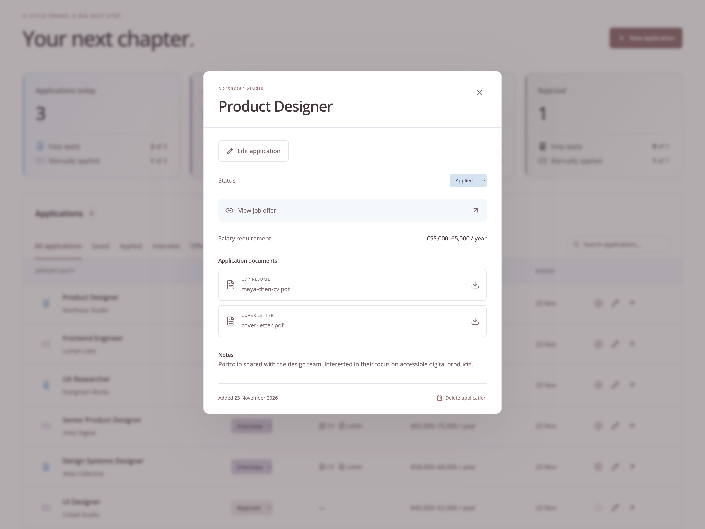
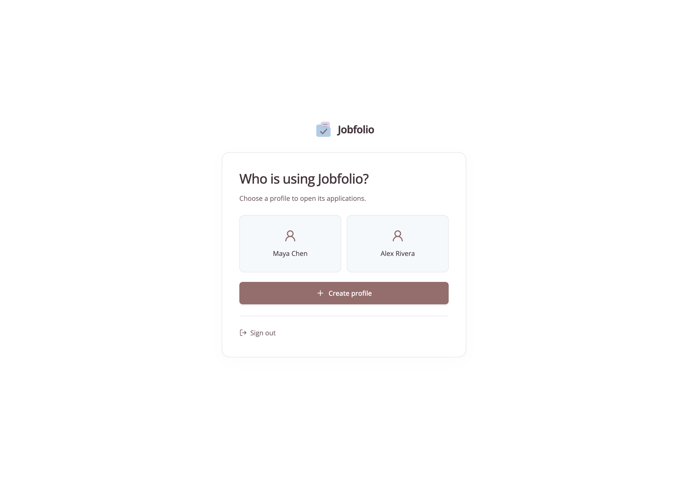

# Jobfolio

A simple workspace for your job search. Keep opportunities, application progress, notes, CVs, and cover letters together.

*All screenshots use fictional profiles, companies, and application details from an isolated local demo.*

## What you can do

- **Track applications:** organize roles by Saved, Applied, Interview, Offer, Rejected, or Closed.
- **See your progress:** view today's applications, this week's entries, interviews, and rejections, with Easy apply and Manually applied breakdowns.
- **Keep documents together:** attach a CV and cover letter to each opportunity, then download, replace, or remove them later.
- **Manage your profile:** click your username or avatar to change its name, download your applications as CSV, or delete the profile after confirmation.
- **Find and update entries:** search by role, company, or notes; filter by status; edit details; or mark an application as rejected from its row.

## How to use

1. **Enter the shared PIN**, then choose a profile or create one. Click your username or avatar in the navbar to manage your profile; use **Switch profile** on that page to choose another, or the sign-out icon to leave.
2. **Click New application.** Select **Easy apply**, **Manually applied**, or both. At least one is required; the remaining fields are optional.
3. **Add the opportunity details:** job title, company, job link, salary expectation, and notes. Attach documents if needed, then click **Save application**. New entries start as **Saved**.
4. **Update the status** as things progress using the status selector. The circled cross in the last column marks an entry as **Rejected**.
5. **Open an application** by clicking its role or view icon. Read notes, download documents, edit the entry, or delete it after confirmation. Use the search box and status tabs to narrow the list.

Supported attachments: **PDF, DOC, DOCX, and TXT**, up to **10 MB per file**.

The **Applications today** card counts entries added today that are currently Applied. **Applications this week** counts all entries added Monday–Sunday. **Interviews** and **Rejected** count entries with those current statuses. Counts use your local date and include the full profile, regardless of search or filters. An entry with both application methods selected appears in both method breakdowns.

Profiles keep records organized separately. Everyone who knows the shared PIN can select any profile; no ChatGPT account is required.

## More screenshots

### Add an application

Choose the application method, add optional details, and attach documents.

### View details and documents

Review an opportunity's status, salary, documents, and notes in one place.

### Choose a profile

Open an existing profile or create a new workspace for your applications.

## Built with

React, TypeScript, and Vinext, with Cloudflare Workers, D1 for application records, and R2 for documents.
